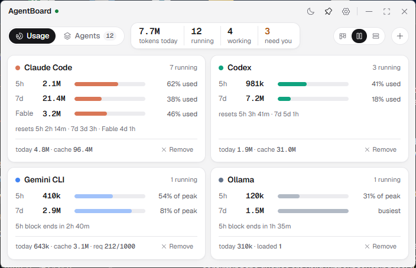
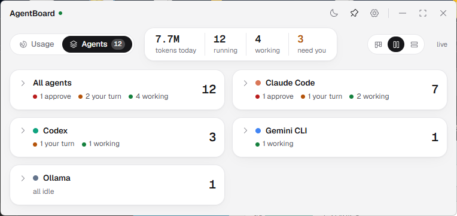
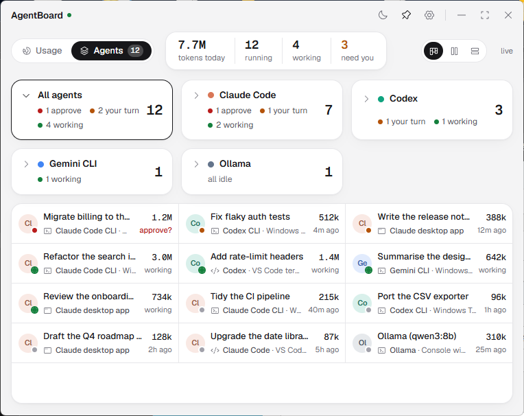
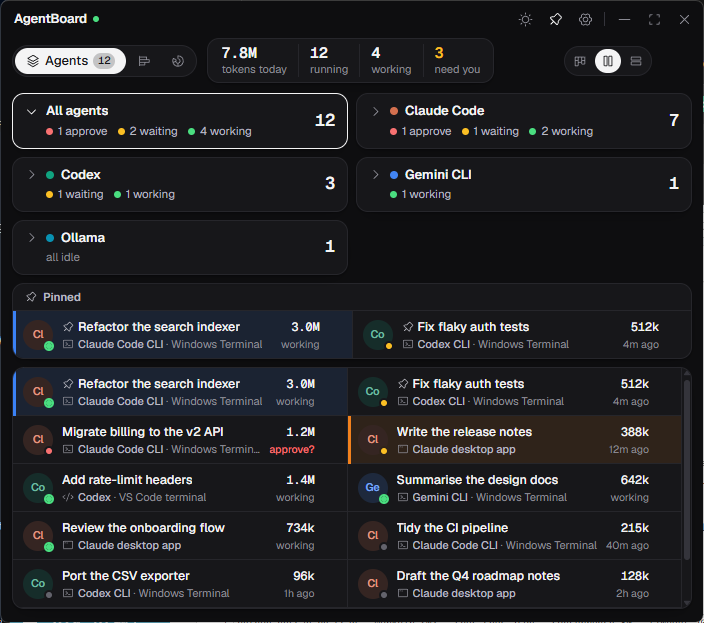
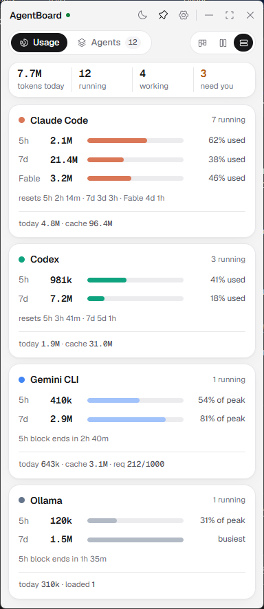
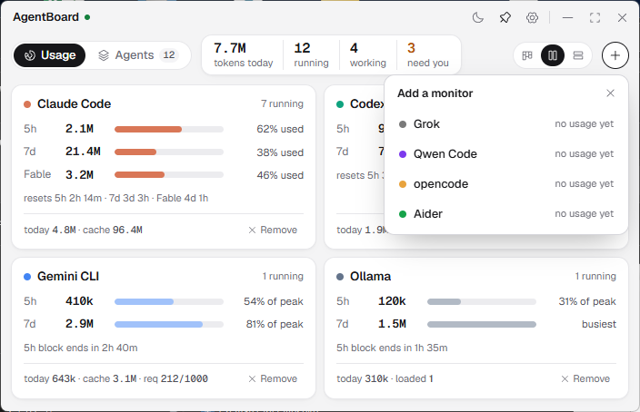
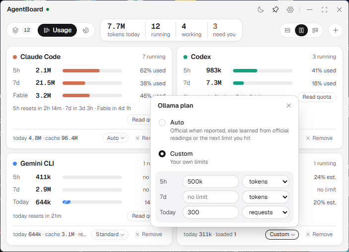
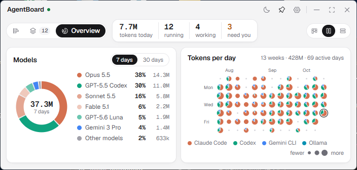
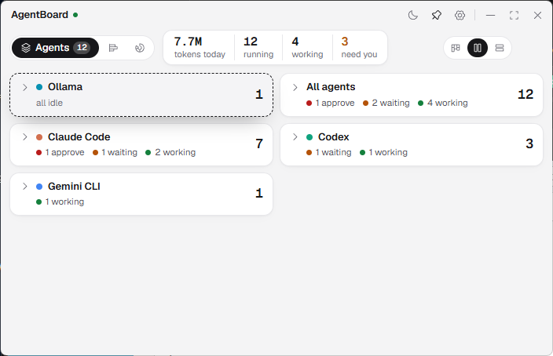
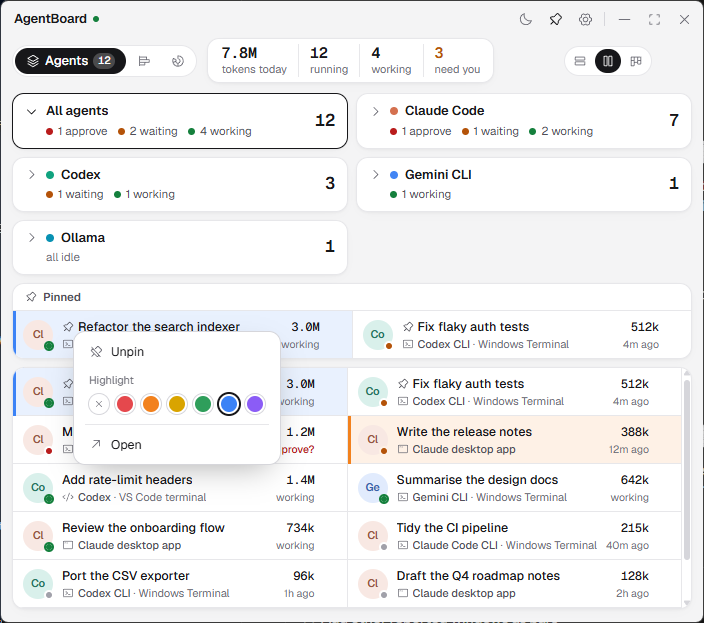

# AgentBoard

A compact, landscape, always-on-top Windows panel for all your coding agents.

- **Three pages, in this order: Agents, Usage and Overview.** Switching pages never moves or resizes the window, and the new page slides and fades in.
- **Agents page**: a tile for **All agents** and one for each agent type. Click a tile to show its agents below in a five-row scrolling list; the window grows if it needs the room. Each agent shows its status and where it runs: Claude Code CLI in Windows Terminal, the Claude desktop app, Codex CLI, Codex in a VS Code terminal, and so on.
- **Usage page**: a monitor (card) per agent type, with a bar for each limit window: the 5-hour window, the last 7 days and, for Claude, Fable's own weekly window. Each bar shows tokens used as a % of the quota. The small **+** adds a monitor for any agent type, and **× Remove** hides one.
- **Overview page**: each model's share of your tokens over 7 or 30 days, and a calendar of tokens per day, a month at a time with arrows to go back, where each day's circle shows how much you used and how it split between agents.
- **Columns**: small buttons in the toolbar lay out every page in 1, 2 or 3 columns. It is one setting for all pages.
- **Pin and highlight**: right-click an agent to pin it, so it stays listed under the tiles, or to mark it with a colour.
- **Your order**: drag the agent tiles, and the sessions in a list, to put them in the order you want.
- **Click an agent** to open it exactly where it runs:
  - a Claude desktop session opens in the Claude app;
  - a terminal agent's own tab is selected, even when several tabs have the same title.

It works with Claude Code, Codex, Gemini CLI, Grok, Qwen Code, opencode, Aider and local models (Ollama). You can add any other CLI agent in the settings file.



| Agents, tiles only | Agents in 3 columns, All agents open | Pinned and highlighted sessions (dark) |
| --- | --- | --- |
|  |  |  |

These screenshots use the built-in demo data (`--demo`), so the names are made up.

## Run it

1. Install Python 3.10 or newer if you don't have it.
2. Double-click **`run.bat`**.
   - On the first run it installs `psutil` and `pywebview`.
   - The window is drawn by Microsoft Edge WebView2, which comes with Windows 11.

The window opens in the bottom-right corner and stays on top of other windows. Its width is fixed: about 720px, or about 400px in single-column mode. Its height fits the tallest of the three pages, so switching pages leaves the window where it is and the same size. It changes only when the content does, for example when an Agents list opens or a monitor is added. In the lower half of the screen it grows upwards, so it stays clear of the taskbar.

In the title bar:
- the moon or sun icon switches between light and dark (it follows Windows until you choose);
- the pin keeps the window on top or lets it go behind others;
- the gear opens the settings file;
- minimise, maximise and close. Maximise fills the screen the window is on, above the taskbar, and the cards spread into one row. Click it again, or double-click the title bar, to go back.

Under the title bar, on the right:
- three small buttons set the columns: 1, 2 or 3. The choice applies to every page, and on the Agents page to both the tiles and the agent list;
- on the Usage page, a small **+** adds a monitor (see below).

The dot next to the name is green while the data is live, and grey if refreshing has stopped. Hover over it to see when the data last updated.

One column makes the window narrow:
- it shrinks to about 400px, keeping its right edge where it was;
- today's totals move to their own row under the page switch.

Switching back to 2 or 3 columns widens the window again.



The page switch shows the name of the open page; the other pages show just their icon. Press **Ctrl+1** for Agents, **Ctrl+2** for Usage and **Ctrl+3** for Overview. Drag the bare title bar to move the window.

When you switch, the open tab's name unfolds and the new page slides in from that tab's side while the old one fades out. If Windows **Animation effects** is off (Settings > Accessibility > Visual effects), the pages only cross-fade, without sliding.

Other ways to run it:

| Command | What it does |
| --- | --- |
| `python -m agentboard --demo` | Opens the window with made-up agents, so you can try it without running any. |
| `python -m agentboard --once` | Prints one text snapshot, to check your setup. |
| `python -m agentboard --tabs` | Lists the Windows Terminal tabs the app can see. |

## Usage page: 5-hour, 7-day and Fable bars

### Choosing the monitors

Each card is a monitor for one agent type. Agent types that are running now or were used recently get a monitor by default.
- **Add one**: click the small **+** at the right of the toolbar. A small panel floats under it, over the monitors, listing every agent type in your settings that has no monitor yet: Claude Code, Codex, Gemini CLI, Grok, Qwen Code, opencode, Aider, Ollama and your own. Pick one to add it, even if it hasn't been used yet. If the window is too short for the list, it grows while the panel is open. Press Esc or ×, or click anywhere else, to close it. When every agent type has a monitor, the **+** is greyed out.
- **Remove one**: click the small **× Remove** at the bottom of the monitor. It stays hidden, even while that agent is in use, until you add it back.

AgentBoard remembers your choice in its window's own storage on this PC.



### Reading a monitor

Each bar shows the tokens used in one window, and how full that window is:
- **`5h`**: the current 5-hour window.
- **`7d`**: the last 7 days.
- **`Fable`** (Claude only): tokens used with Claude Fable models in the last 7 days. Claude plans meter Fable on a weekly limit of its own.
- **Other windows the CLI reports**, such as **`30d`** for Codex on the free plan: each gets its own bar with the official %, and tokens are counted over that window.
- **Next line**: when the windows reset (`5h resets in 2h 14m · 7d in 3d 3h · Fable in 4d 1h`), or, without official limits, when the current 5-hour block ends.
- **Read quota**: on a Claude Code or Codex card with no official % at all, a small button sits at the right of that line. It re-reads the logs and the status line at once, learns from any new limit hit, and says what it found: the official %, an estimate from a limit hit, or nothing yet. It opens nothing and sends nothing over the network; AgentBoard reads all of this on its own every 15 seconds anyway.
- **Bottom line**: today's tokens, cache reads, and, where relevant, requests or loaded local models.

Where the percentage comes from depends on what is available:

| Shown as | When | Meaning |
| --- | --- | --- |
| `42% used` | The CLI reports its own limits: Codex in its logs, and Claude Code once you enable the optional status line (see below). | The official percentage of your 5-hour or weekly limit. Tokens are counted over the same window. It always wins over an estimate. |
| `42% est.`, or `23 of 15–160` | You picked a plan for the monitor, or Auto has learned your limit from official readings or from a limit you hit (see **Plans** below). | An estimate, drawn with a striped bar so it isn't mistaken for an official figure. |
| `42% of 3.0M` | You set your own limits in the settings file (`limit_tokens` for 5 hours, `limit_tokens_7d` for 7 days, `limit_tokens_fable` for Fable). | Tokens against your own limit. |
| `no quota` | None of the above | Only the tokens are shown, with an empty bar, until a quota is known. Pick a plan or set a custom limit to get a %. |
| `not used`, `no limit` | No tokens in that window; or a local model, or a plan with no limit for that window | |

### Plans: an estimate where the agent reports no %

Most agents don't save their limit usage on your PC, so AgentBoard can't show their official %. Instead, each monitor has a small plan chip at the bottom (it reads **Auto** at first). Click it to choose how to estimate:

| Choice | How the % is worked out |
| --- | --- |
| **Auto** | Each time a window has an official % (Claude's status line, Codex's logs), AgentBoard notes how many tokens 100% came to, and it uses the middle of the recent readings when the official figure is missing. Without official readings, it learns from the rate limits you hit (see below). Until it has learned something, the window shows `no quota`. |
| **A vendor plan** | The plan's published limits, counted the same way the vendor counts them: tokens, requests (model replies) or messages (prompts you typed). A daily limit adds a **Today** bar, reset at midnight Pacific as Google does. |
| **Custom** | Your own limits for 5h, 7d and Today, each in tokens, requests or messages. Type amounts like `3M`, `500k` or `1,500`. |

The plans in AgentBoard use only what the vendors publish (October 2026):

| Agent | Plans | Published limit |
| --- | --- | --- |
| Codex | Plus, Business | 15–160 local messages per 5 hours (GPT-6.1 Sol; other models differ). The bar runs to 160 and turns amber from 15. |
| Codex | Pro | No 5-hour limit. The weekly limit isn't published. |
| Gemini CLI | Code Assist Standard, Enterprise, Free | 1,500, 2,000 and 1,000 requests a day. Google may no longer serve free CLI requests. |
| Claude Code | none | Anthropic publishes no token or message counts for Pro or Max, so use **Auto** (with the status line) or **Custom**. |
| Grok, Qwen Code, others | none | xAI publishes no numbers (Grok plans share one weekly pool), and the free Qwen tier closed in April 2026. Use **Custom**. |

Vendors change their limits often, so the panel shows when the figures were checked. Your choices, and what Auto has learned, stay on this PC.

### Learning from the limits you hit

When Claude Code stops because you reached a limit, its log records the refusal: which limit (5-hour or weekly) and when it resets. That window then held exactly 100%, so AgentBoard counts the tokens from the window's start up to the hit and uses that as an estimate of the limit (the middle of your last five hits). This needs no CLI session and no network: it works for Claude desktop app sessions too, and it is what Auto falls back on when no official % comes in, for example on organization plans, which don't get the status line's limits.
- The 5-hour bar then shows `x% est.`, and its tooltip says which hit it was learned from.
- The learned limit is kept in `%USERPROFILE%\.agentboard\limits.json`, so it survives Claude Code deleting old logs.
- A hit older than 25 days isn't used: Claude Code deletes transcripts after 30 days, so most of that window's logs are already gone and the count would be too low.
- A learned limit is dropped once a later window goes more than 10% past it without a hit (a bigger plan, or a count that was too low).
- Tokens are a stand-in: Anthropic weighs usage by model, and sessions on other devices or on claude.ai aren't in your logs. The estimate is a guide, not the official figure.



For Fable, Claude Code shows the official weekly percentage on its `/usage` screen, but doesn't pass it to the status line yet. Until it does, the Fable bar uses your own limit, or shows `no quota`. AgentBoard already reads the field Claude Code uses for per-model windows (`model_scoped`), so the bar switches to the official figure once the status line includes it.

Claude's limits are per account, so one Claude Code CLI session with the status line enabled is enough. Its percentages then cover your desktop app sessions too. The figures are kept for up to 6 hours after the last CLI update.

A bar and its percentage turn amber at 80% and red at 95%, but only for official limits, plan estimates and your own limits. Hover over a bar to see the details.

"Tokens" means new input (including cache writes) plus output. Cache reads, meaning reused context, are shown separately, because they are much larger and cheaper. Anthropic and OpenAI don't publish their limits in tokens, so the token counts are a guide. The official percentage is the real measure.

## Overview page: models and days

The window keeps its width. In 2 or 3 columns the two cards sit side by side, and in 1 column they stack.

- **Models**: a donut of each model's share of your tokens, over the last **7 days** or **30 days** (the small switch). The total is in the middle.
  - A model takes its agent's colour. A second or third model of the same agent, such as Sonnet next to Opus, gets a lighter tint of it.
  - Past six models, the rest go into **Other models**.
  - The legend lists each model's share and tokens. Hover over a slice for its agent.
- **Tokens per day**: one month as a calendar, a row per week with Sunday first, filling the card's width. Today's date is bold and its circle is ringed.
  - Each day shows its date and a circle. The circle's size shows the day's tokens compared with the month's busiest day, and its slices show each agent's share of that day.
  - The **‹ ›** arrows step to the previous or next month, back to the first month AgentBoard has data for. It opens on the current month.
  - Under the calendar: the agents' colours and the month's tokens and active days.
  - Hover over a day for its date, tokens and split.

Days are your PC's local dates. Agents delete old logs (Claude Code removes transcripts after 30 days by default), so AgentBoard keeps each finished day's tokens per agent type in `%USERPROFILE%\.agentboard\days.json`. Past months then stay on the calendar after their logs are gone. The calendar starts from the oldest day in your logs or in that file.



The agent colours were checked with a colour-vision validator in light and dark mode, so that agents stay apart for most kinds of colour blindness. The legends and tooltips name each agent too.

## Agents page: where each agent runs

The page starts with tiles only: one for **All agents** and one for each agent type. Each tile shows its agent count, and how many need approval (red), are waiting for you (amber) and are working (green).

Click a tile to list its agents below the tiles, and the window grows to fit the list. The list is always five rows tall, with 1, 2 or 3 agents per row depending on the column setting; any more scroll inside it. Click the tile again to hide the list, and the window shrinks back. Only one tile is open at a time. Each agent shows:
- the session title;
- a status dot:
  - red: it stopped on a tool call, probably waiting for approval;
  - amber: waiting, because it finished and is waiting for you;
  - green, pulsing: working;
  - grey: idle;
- its tokens in this session;
- **where it runs**, with an icon:

| Label | Icon | Meaning |
| --- | --- | --- |
| `Claude Code CLI · Windows Terminal`, `Codex CLI · Windows Terminal`, `Gemini CLI · Console window` | terminal | the CLI, in a terminal tab or a classic console window |
| `Claude desktop app` | app window | a session inside the Claude desktop app |
| `Codex · ChatGPT app` | app window | Codex inside the ChatGPT desktop app |
| `Codex · VS Code terminal`, `Claude Code · Cursor terminal` | code | the CLI in an IDE's built-in terminal |

Hover over an agent to see the model, folder and process ID. Click **need you** at the top to open **All agents**.

### Reorder tiles and sessions

Drag a tile, **All agents** included, to where you want it; the other tiles slide out of the way. Sessions work the same way: drag a row in the open list or in the **Pinned** list. Pinned rows stay above the others, so dragging a pinned row changes the pin order.

A short click still opens the tile or the session; a drag never does. If the list scrolls, dragging near its top or bottom edge scrolls it. From the keyboard, select a tile or row and press **Alt** with an arrow key to move it one place.

AgentBoard remembers both orders on this PC. An agent type or session that isn't running keeps its place for when it comes back; new sessions are added after the ones you placed.



### Pin and highlight important sessions

Right-click an agent, in any list, to open its menu:
- **Pin to top** keeps the session in a **Pinned** list under the tiles, which shows whichever tile is open. Pinned sessions also come first in every list, with a pin icon. **Unpin** removes it.
- **Highlight** marks the row with one of six colours: a stripe on the left and a light tint. **×** removes the colour.
- **Open** does the same as a click.

Pins and colours belong to the session, not the process: the Claude app's session id, or else the CLI session file. They stay when AgentBoard or the PC restarts, and AgentBoard remembers them on this PC. A Claude desktop session keeps them even when the app restarts its agent process.



## How the jump works

| Where the agent runs | What a click does |
| --- | --- |
| Windows Terminal tab | Switches to **that exact tab** and brings the window to the front. |
| Classic console window (cmd or PowerShell) | Brings that console window to the front. |
| VS Code, Cursor, Windsurf, Kiro or JetBrains terminal | Brings the IDE window to the front. The IDE's own terminal panel can't be selected from outside. |
| Claude desktop app | Opens **that exact session** in the Claude app and brings the app to the front. |
| ChatGPT (Codex) app | Brings the app to the front. Select the thread there. |

For a Claude desktop session, AgentBoard:
1. looks up the app's own record of the session, in `%APPDATA%\Claude\claude-code-sessions`, which links the app's session id to the Claude Code session it runs;
2. asks the app to open it with the app's own link, `claude://code/continue?session=local_…`. The app's taskbar jump list uses the same link.

Tested on Windows 11 with Claude app 3.1623: AgentBoard opened one session and then another, and each was focused, judging by the app's record of when it was last focused.

To find the exact terminal tab, AgentBoard:
1. briefly gives the agent's console a unique title, such as `AgentBoard 1234 a1b2c3`;
2. selects the tab showing that title through Windows UI Automation, which is built into Windows;
3. puts the agent's own title back straight away.

This works even when two tabs have the same title, and even while an agent animates its title with a spinner. You may see the marker flash in the tab for a fraction of a second.

If the marker can't be set, AgentBoard falls back to matching the tab title. In that case, clicking again moves to the next tab with the same title.

Tested on Windows 11 with two stand-in agents in one Windows Terminal window, both with the same title:
- With fixed titles, 8 of 8 jumps landed on the right tab, about 0.3 seconds each, and both titles were restored.
- With titles repainted ten times a second, 8 of 8 jumps also landed on the right tab.

## Add another agent, including local-model agents

Click the gear. This creates and opens `%USERPROFILE%\.agentboard\config.json`. Add an entry, then restart AgentBoard:

```json
{
  "agents": [
    {"id": "my-agent", "name": "My local agent", "color": "#0ea5e9", "local": true,
     "match": {"cmd_regex": "\\bmy-agent\\b"},
     "reader": "generic", "logs": ["~/.my-agent/**/*.jsonl"],
     "quota": {"kind": "unlimited"}}
  ]
}
```

- **`match`** is either a process name (`"exe": ["my-agent.exe"]`) or a regular expression over the command line.
- **`reader: generic`** reads any JSON or JSONL log with token counts in a common format: Anthropic, OpenAI, Gemini or Ollama (`prompt_eval_count` and `eval_count`). If the agent keeps no usage log, use `none`. It is still listed, with its status based on CPU activity.
- **To change a built-in agent**, give its `id`. For example, to set your own Claude token limits per 5 hours and per 7 days, and a Gemini daily request budget:

```json
{"agents": [{"id": "claude", "quota": {"fallback": {"limit_tokens": 3000000, "limit_tokens_7d": 30000000, "limit_tokens_fable": 10000000}}},
            {"id": "gemini", "quota": {"limit_requests": 1000}},
            {"id": "grok", "logs": ["D:/somewhere/grok-sessions/**/*.jsonl"]}]}
```

Built-in log locations:

| Agent | Logs |
| --- | --- |
| Claude Code | `~/.claude/projects` |
| Codex | `~/.codex/sessions`, plus thread titles from its state database, opened read-only |
| Gemini CLI | `~/.gemini/tmp/*/chats` |
| Qwen Code | `~/.qwen/tmp/*/chats` |
| opencode | `~/.local/share/opencode/storage` |
| Grok | `~/.grok`. This is a guess, because Grok Build doesn't document where it stores sessions. Point `logs` at the right folder if yours differs. |

## Optional: exact Claude limits in the CLI

Claude Code passes its 5-hour and 7-day usage to the status-line command. To let AgentBoard show it:
1. Copy `hooks/claude_statusline.py` to `%USERPROFILE%\.agentboard\`.
2. Add this to `~/.claude/settings.json`, adjusting the paths to your Python and user folder:

```json
"statusLine": {"type": "command", "command": "\"C:/Program Files/Python313/python.exe\" \"C:/Users/you/.agentboard/claude_statusline.py\""}
```

Claude Code includes the 5h and 7d figures once it has had a reply from the API, so they appear after your next message in a CLI session.

Your status line will then read like `Opus · 5h 42% · 7d 12%`, and the Claude 5h and 7d bars switch to the official limits. Sessions inside the Claude desktop app don't run a status line, but because the limits are per account, one CLI session is enough to show them.

The command must point at a folder that stays put. If the file moves, the status line just stays empty.

## Privacy

AgentBoard only reads files on this PC:
- agent logs: token counts, timestamps, models and session titles, never the conversation text;
- Codex's state database, in read-only mode;
- the Claude app's session records: only the ids, title, archive flag and last activity time.

For the Overview calendar it keeps `days.json` in `%USERPROFILE%\.agentboard`: dates and token counts per agent type, nothing else. Next to it, `limits.json` holds the limits learned from your limit hits: the limit type, the times and a token count. Your choices on the page (monitors, plans, pins, order) stay in the window's own storage.

It never logs in anywhere, never uses your saved credentials, and never sends data anywhere. Its one network call goes to your own Ollama server at `127.0.0.1`, to list the loaded models.

The window's page is served from a local web server that only this PC can reach.

## Known limits

- **The official Fable percentage isn't available yet.** Claude Code shows it only on its `/usage` screen, so the Fable bar uses your own limit or shows `no quota` (see the Usage page section).
- **Official Claude limits need a CLI session.** Claude doesn't store the 5h and 7d percentages on disk for desktop app sessions, so without a Claude Code CLI session with the status line, the bars use what Auto has learned (from official readings or from your limit hits), your own limits, or show `no quota`. Claude Code's own docs say the status line's limits come only for claude.ai Pro and Max accounts, and Claude Code's background `/usage` report has no plan usage on organization plans either.
- **The Claude session link** is the app's own, but it isn't documented, so a future app version could change it. If it stops working, the click still brings the app to the front.
- **Codex inside the ChatGPT app** runs as one background process for all its threads, so it appears as one agent, and a click only brings the app to the front. History that Codex imported from other agents is not counted as Codex usage. On the free plan, Codex reports a 30-day window instead of 5h and 7d ones, so the card shows a **30d** bar with the official %, while 5h and 7d show `no quota` unless you pick a plan.
- **Not tested live**: Gemini CLI, Grok, Qwen Code and opencode weren't installed on the test PC. Their log readers are tested with sample logs in each tool's format (`tests/test_readers.py`).
- **Exact tab jump** was tested with stand-in agents, not with live Claude Code or Codex CLI tabs. It relies on the same console-title mechanism those CLIs use.
- **Ollama** doesn't log tokens per request. Local tokens appear only when the agent using Ollama logs them, as opencode does.
- **Status is inferred from logs.** "approve?" (needs approval) means the agent stopped on a tool call with no activity for 45 seconds, which is usually an approval prompt. A long, silent command can look the same.

## Files

```
run.bat                          start the panel (no console window)
agentboard/app.py                the window (pywebview) and the calls the page can make
agentboard/web/                  the page: index.html, styles.css, app.js
agentboard/web/vendor/           Geist fonts and Phosphor icons (both open licences), stored locally
agentboard/core/engine.py        refresh loop and the snapshot the page draws
agentboard/core/procs.py         finds agent processes, their host and their surface label
agentboard/core/usage.py         reads logs: tokens, limits, 5h, 7d and per-model windows, session status
agentboard/core/focus.py         jump to the window, the exact Windows Terminal tab or Claude app session
agentboard/core/claude_app.py    Claude app session records and its session link
agentboard/core/console_probe.py reads or temporarily marks a console's title
agentboard/core/wt_tabs.ps1      UI Automation helper for Windows Terminal tabs
agentboard/core/config.py        built-in agent types and your settings
agentboard/core/demo.py          made-up data for --demo
hooks/claude_statusline.py       optional Claude Code status line
tools/vendor.py                  re-downloads the fonts and icons
tests/test_readers.py            reader tests with sample logs
```
